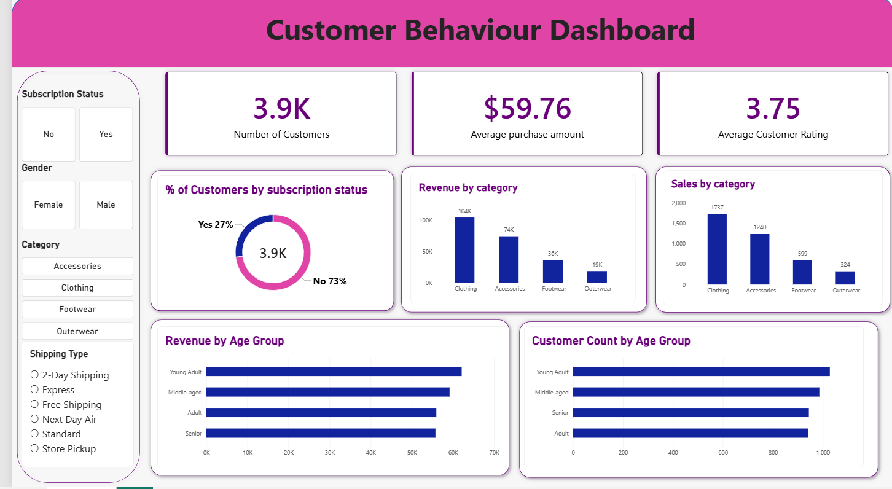
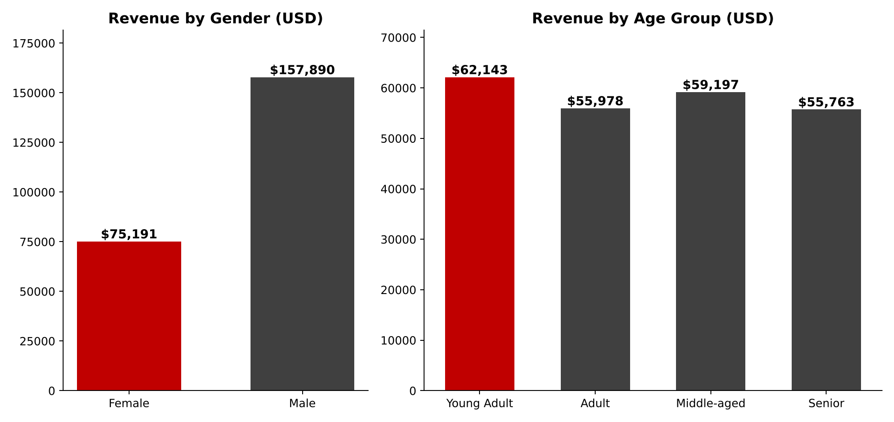
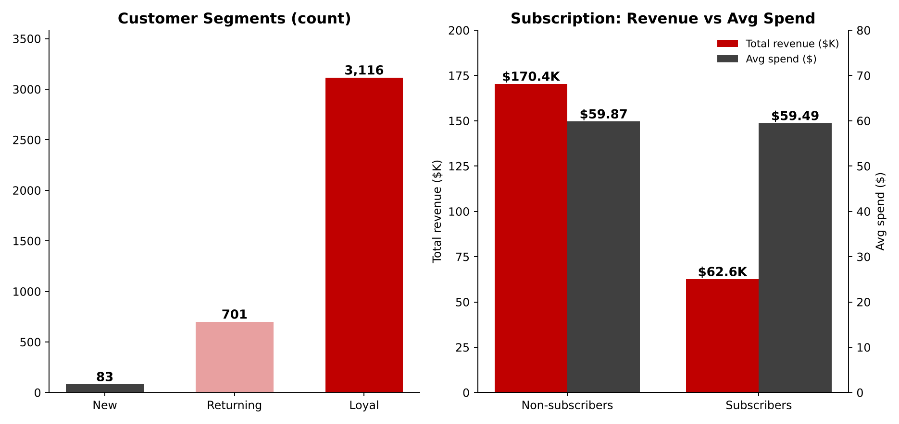
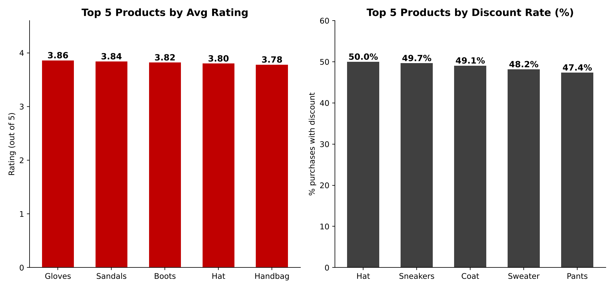
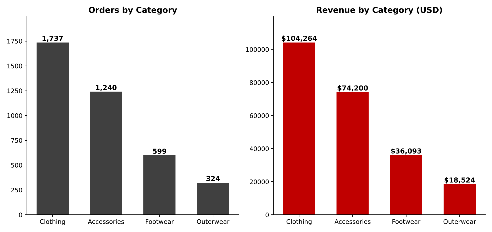

# 🛍️ Customer Shopping Behavior Analysis

**End-to-end data analytics project using Python, PostgreSQL & Power BI** — turning 3,900 raw retail transactions into clear, actionable business insights.




---

## 📌 Overview

Retailers need to know *who* buys, *what* they buy and *what drives* spend. This project analyses customer shopping behavior across revenue, demographics, discounts, subscriptions, shipping and loyalty.

| Stage | Tool | What was done |
|---|---|---|
| 1. Clean & engineer | Python (Pandas) | Imputed missing ratings, standardised columns, built new features |
| 2. Store & query | PostgreSQL | Loaded cleaned data, answered 10 business questions in SQL |
| 3. Visualise | Power BI | Interactive dashboard with KPI cards, charts and slicers |

## 🎯 Objectives

- Clean and feature-engineer raw customer shopping records
- Store the data in PostgreSQL and answer business questions with SQL
- Identify revenue drivers (gender, age group, category, subscription)
- Segment customers into **New / Returning / Loyal**
- Build an interactive dashboard for decision-making

## 📊 Dataset

| Property | Value |
|---|---|
| File | `data/raw/customer_shopping_behavior.csv` |
| Size | 3,900 rows × 18 columns (19 after feature engineering, 1 redundant column dropped) |
| Key fields | age, gender, item, category, purchase amount (USD), location, season, review rating, subscription status, shipping type, discount applied, previous purchases, payment method, purchase frequency |
| Missing values | 37 `Review Rating` values (~1%) |

**Headline numbers:** $233,081 total revenue · $59.76 average purchase · 3.75 average rating.

## 🧹 Data Cleaning & Feature Engineering (`src/clean_data.py`)

1. Filled missing **Review Rating** with the **category median**
2. Renamed columns to `snake_case` (`Purchase Amount (USD)` → `purchase_amount`)
3. Created **`age_group`** using quartiles — Young Adult (18–31), Adult (32–44), Middle-aged (45–57), Senior (58–70)
4. Created **`purchase_frequency_days`** from `frequency_of_purchases` (e.g. Weekly → 7, Quarterly → 90)
5. Dropped **`promo_code_used`** — identical to `discount_applied` (verified programmatically)

## 🗄️ SQL Analysis (`sql/queries.sql`)

10 business questions answered with PostgreSQL, using aggregations, subqueries, CTEs, `CASE` and window functions (`ROW_NUMBER`):

| # | Question |
|---|---|
| Q1 | Revenue by gender |
| Q2 | Discounted purchases that still exceeded the average spend |
| Q3 | Top 5 products by average review rating |
| Q4 | Average purchase: Standard vs Express shipping |
| Q5 | Do subscribers spend more? |
| Q6 | Top 5 products by discount rate |
| Q7 | Customer segmentation (New / Returning / Loyal) |
| Q8 | Top 3 products within each category |
| Q9 | Are repeat buyers more likely to subscribe? |
| Q10 | Revenue contribution by age group |

## 🔍 Key Findings

- **Gender:** Male customers generate **$157,890 (68%)** vs Female **$75,191 (32%)**
- **Category:** **Clothing leads with $104,264 (45%)** of revenue; Outerwear is the smallest
- **Age:** **Young Adults (18–31)** contribute the most — $62,143 (27%)
- **Subscription:** Does *not* raise spend — subscribers average $59.49 vs $59.87 for non-subscribers
- **Discounts:** Used in 1,677 of 3,900 purchases (43%); **Hat** has the highest discount rate (50%); 839 discounted purchases still beat the average spend
- **Shipping:** Express averages $60.48 vs Standard $58.46 per order
- **Loyalty:** 3,116 Loyal · 701 Returning · only 83 New customers
- **Repeat buyers (>5 purchases):** 958 of 3,476 (~28%) are subscribed

> ⚠️ **Limitation:** Averages differ only slightly between groups, so these findings indicate trends, not strong causal effects.

### Visuals

| | |
|---|---|
|  |  |
|  |  |

## 📁 Project Structure

```
customer-shopping-behavior-analysis/
├── data/
│   ├── raw/                     # Original dataset
│   └── processed/               # Cleaned dataset (generated)
├── src/
│   ├── clean_data.py            # Cleaning + feature engineering
│   └── load_to_postgres.py      # Load cleaned data into PostgreSQL
├── sql/
│   └── queries.sql              # 10 business queries
├── dashboard/
│   └── Customer_Behavior_Dashboard.pbix
├── presentation/
│   └── Customer_Behavior_Analysis.pptx
├── docs/images/                 # Screenshots used in this README
├── report/                      # Project report (coming soon)
├── .env.example                 # Template for DB credentials
├── requirements.txt
├── LICENSE
└── README.md
```

## 🚀 How to Run

```bash
# 1. Clone and install
git clone https://github.com/schiragb/customer-shopping-behavior-analysis.git
cd customer-shopping-behavior-analysis
pip install -r requirements.txt

# 2. Clean the data  ->  data/processed/customer_shopping_behavior_cleaned.csv
python src/clean_data.py

# 3. Load into PostgreSQL (create a database named customer_behavior first)
cp .env.example .env        # then put your own DB password in .env
python src/load_to_postgres.py

# 4. Run the analysis
psql -d customer_behavior -f sql/queries.sql
```

**Dashboard:** open `dashboard/Customer_Behavior_Dashboard.pbix` in Power BI Desktop. If the data source path breaks, re-point it to the cleaned CSV or your PostgreSQL table.

## 🔭 Future Scope

- Predictive models for churn and customer lifetime value
- RFM-based customer segmentation
- Automated pipeline (scheduled refresh of the dashboard)
- Statistical significance tests on group differences

## 📄 Project Report

The detailed report will be added to [`report/`](report/) soon.

## 🏅 Internship Certificate

Completed a Data Analysis (Power BI) internship at **Cognijoint Infotech** (16 May – 30 June 2026). The certificate is available in [`certificate/`](certificate/23ESKCY012_ChiragSharma_InternshipCertificate.pdf).

## 👤 Author

**Chirag Sharma** — B.Tech CSE (IoT), Swami Keshwanand Institute of Technology, Jaipur

[](https://github.com/schiragb)
[](https://www.linkedin.com/in/chirag-sharma-968858253)

*Built during a Data Analysis (Power BI) internship at Cognijoint Infotech, May–June 2026.*

## 📜 License

Released under the [MIT License](LICENSE).
